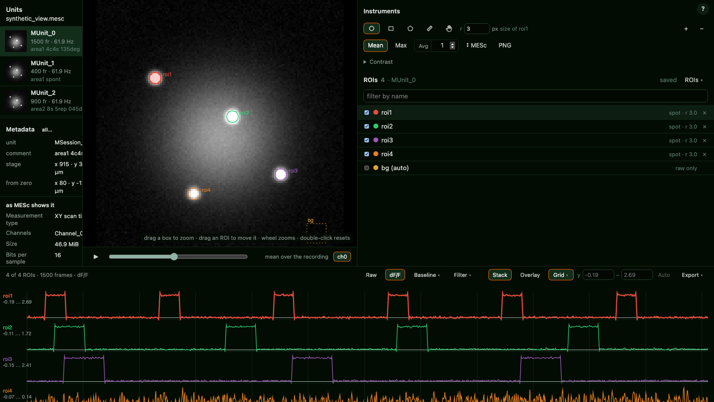
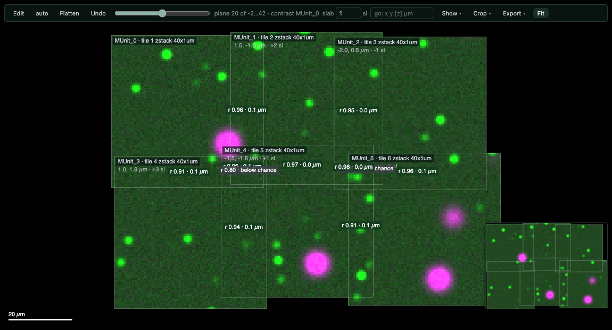

# mesc-io

[](https://github.com/LynnYuSmith/mesc-io/actions/workflows/tests.yml) [](https://pypi.org/project/mesc-io/) [](https://pypi.org/project/mesc-io/) [](LICENSE)

Reads Femtonics `.mesc` two-photon recordings without MESc. The HDF5 file is read directly, on
macOS, Linux or Windows, from Python, the command line or a browser. Frames are returned in the
units the native reader shows, with the metadata of every unit. Further functions: export to Fiji
(which has no `.mesc` reader), write-back of processed frames, motion correction, and a viewer
that draws ROIs and computes their dF/F.



## Install

```
pip install mesc-io
pip install "mesc-io[tiff,imagej]"     # + TIFF export, ImageJ ROI export
```

Requires Python ≥ 3.9, numpy and h5py. Reading and viewing need nothing else. Extras:
`[tiff]` for the mosaic crop to TIFF, `[imagej]` for the ImageJ ROI export, `[register]` for
motion correction (installs Suite2p 0.14).

On Windows, Python from conda or python.org often has no `Scripts` folder on the PATH. The
console then reports `pip` or `mesc-io` as "not recognized". In an activated conda environment
the commands work as written; otherwise call them through Python:

```
py -m pip install mesc-io
py -m mesc_io view "C:\path\to\recording.mesc"
```

The viewer runs as long as its console window is open. Ctrl+C in that window stops it.

## Python

```python
from mesc_io import MescFile

with MescFile("recording.mesc") as f:
    for u in f.units():
        print(u.path, u.shape, u.frame_rate_hz, u.pixel_size_um)

    frames = f.read("MUnit_0", channel=0)              # reader units, float64
    frames = f.read("MUnit_0", reader_units=False)     # the stored integers
    for block in f.iter_frames("MUnit_0", block=500):  # bigger than memory
        ...
    t = f.frame_times("MUnit_0")                       # hardware stamp per frame, seconds
    f.frame_stalls("MUnit_0")                          # [(frame, seconds lost), ...]

    u = f.unit("MUnit_0")
    u.laser_pockels, u.pmt_reference_voltage           # 400.0, {"UG": 70.0, "UR": 70.0}
    u.stage_um, u.stage_rel_um                         # stage x, y, z: absolute / from the zero
    u.acquisition["devices"], u.acquisition["params"]  # every acquisition parameter, typed
```

Acquisition parameters are read from `MeasurementParamsXML`: laser (Pockels cell
on-intensity), PMT reference voltages, objective and all others. The unit comment is not used,
since it can disagree with the file.

`f.rig_rois("MUnit_0")` returns the ROIs drawn on the unit in MESc. MESc stores them in the
`ViewerParamsXML` attribute of the unit. Despite the name, this is a base64-encoded Qt
`QDataStream`. mesc-io decodes the ROI list from the public Qt serialisation format. Vertices are
given in µm (field coordinates, as stored) and in pixels.

`frame_times` reads the per-frame time stamps recorded by MESc (`Curve_N`, in clock ticks). The
nominal frame period is slightly off and does not include acquisition pauses (≈ 0.6 s after the
first dark frames when a unit is started in trigger mode). The stamps are therefore the
reference for timing. Z-stacks have no stamps (`None`).

`read` has two safeguards. It refuses more than 4 GB by default (`max_gb=None` overrides). A unit name found in more
than one session is refused rather than resolved to the first match. `MSession_1/MUnit_0` is
always unambiguous.

### Limits of the reader

**PMT A/D inversion, not fully tested.** Inversion is a recording setting (`ad_invert` in
`MeasurementParamsXML`, next to the A/D offsets; added in MESc 3.5.7). mesc-io reads it per
channel (`Channel.ad_invert`). Files recorded with `ad_invert = 1` were tested, and their values
match MESc. Channels recorded with `ad_invert = 0` are read with an `InvertWarning` (reader
units only), and `mesc-io check` reports them as `pmt-not-inverted`. These values have not been
compared with MESc. Some readers apply `65535 − x` by hand.

**8-bit acquisition.** A unit acquired at 8 bits (`BitCompression = 8`) is still stored as
uint16. Each sample is shifted up (`compression_shift_8bit`, 7 in the files tested, i.e.
multiples of 128). One frame therefore holds only a few dozen grey levels. Values are read
unchanged. `Unit.acquired_bits` and `Unit.sample_shift` give the mode. `mesc-io check` flags
such units (`8-bit-acquisition`), since offsets or SNR estimated from single frames are coarse.

Files written by MES 7 or older (`.mes`) have a different format and are not read.

## Command line

```
mesc-io info      recording.mesc                            # units, rates, pixel sizes
mesc-io check     recording.mesc                            # internal inconsistencies of the file
mesc-io rig-rois  recording.mesc --out rois.zip             # ROIs drawn in MESc, for Fiji (or .json)
mesc-io export    recording.mesc MUnit_0 u0.h5              # or u0.tif (Fiji hyperstack)
mesc-io export    recording.mesc all out_folder --tiff      # every unit, one .tif each
mesc-io writeback recording.mesc out.mesc MUnit_0 u0.h5     # processed frames back in
mesc-io view      recording.mesc                            # the recording in a browser
```

`info` and `check` accept `--json`.

### Opening a recording in Fiji

Fiji has no `.mesc` reader (Bio-Formats lists none for Femtonics). Its generic HDF5 import
returns only the stored integers, without units or metadata. `export … .tif` writes a calibrated
hyperstack that Fiji opens with File ▸ Open. It contains:

- all channels (`--channel N` for one), in composite mode, each with its own colour and display range;
- the frame interval (time series) or the slice spacing (z-stack);
- x and y pixel size in µm;
- under Image ▸ Show Info: the unit comment, the units and the conversion of each channel.

Values are in reader units (float32), as in the native reader. `--stored-units` keeps the
stored integers. Frames are streamed, so units larger than memory can be exported.

### Motion correction

```
mesc-io register recording.mesc recording_MC.mesc          # one reference per unit
mesc-io preset save soma --block-size 128 --max-shift-nr 5 # name a set of settings
mesc-io register recording.mesc out.mesc --preset soma     # use it; a flag still wins
```

Requires `pip install "mesc-io[register]"`. Defaults: Suite2p non-rigid registration, 64-px
blocks, `maxregshift` 0.1, non-rigid cap 3 px. Z-stacks and units too short to register are
skipped and listed. Shifts (rigid and per-block non-rigid), references and settings are saved
next to the output as `recording_MC_shifts.npz` (`--shifts PATH`, `--no-shifts`). They are read
with `mesc_io.registration.load_report`. Groups and presets: [docs/registration.md](docs/registration.md).

### The viewer

`mesc-io view` opens the recording in a browser window. Chrome, Firefox, Edge, Brave or
Chromium are opened in a private window if found; otherwise the default browser is used. The
console states which one.

- **left**: units with thumbnails; metadata of the selected unit (rate, pixel size, stage
  position, position relative to the rig zero).
- **middle**: the image. Scrubbing, averaging over N frames, zoom by wheel or box, panning with
  the hand tool.
- **right**: instruments (ROI tools spot, rectangle, polygon, ruler and hand; mean / max;
  ↕ MESc; PNG; contrast) and the ROI list (drag to move, typed size). `bg (auto)` adds the
  darkest-patch background used by the dF/F as a separate trace.
- **bottom**: time course of every ROI, recomputed 0.5 s after the ROIs change. Raw or dF/F
  (`mesc_io.dff`, numpy only: dark current and fitted darkest-patch background removed, then
  rolling-quantile baseline, q = 0.3, 60 s window). Overlaid or stacked, zoom by box.
  **Filter** smooths the display only (Gaussian or Savitzky–Golay; the csv is unfiltered).
  **Grid** adds minor ticks, fixed steps and a zero line. **Export** saves csv or PNG.

Frequent actions are visible; the rest is in a menu at the end of each row. **?** (top right)
opens a guide with all key bindings.

ROIs belong to the unit they were drawn on. ROIs and the view are saved continuously in
`~/mesc-viewer/`, never next to the raw file. Reopening a file restores the last view.

#### Brightness and colour

The image is drawn in **fixed limits**. Default: the display window saved with the recording on
the rig (the LUT of the file, typically 0–2000 in reader units). The window is the same for all
frames, so dimmer frames look dimmer. Bleaching, changes in laser power and focus drift are
therefore visible while scrubbing. Limits can be typed per unit and channel. They are stored in
the view, never in the file; **file** restores the saved ones. **auto %** uses percentiles of
the whole unit, i.e. one window for all frames, so scrubbing does not flicker.

Each channel has a palette: the colour from the file, a single colour, or one of 25 Scientific
colour maps by Fabio Crameri (perceptually uniform: batlow, oslo, lajolla, vik, roma, …).
**Overlay** shows all channels in one image, each with its own limits and colour.
**Brightness, contrast and gamma** (slider or typed value) change the display only, not the
data or the exports. Gamma < 1 brightens dim boutons.

#### Z-stacks: 3D and XYZ

Z-stacks are shown in slices and µm, with a maximum projection, a rotatable **3D** view (MIP,
semi-transparent, or depth-coloured) and **XYZ** orthogonal views through one crosshair.

- **overlay**: two-channel stack in green and magenta, each channel with its own window and
  floor; white where both are bright. Depth colouring uses one channel.
- **point**: brightest voxel under the click. Numbered, with µm position, slice and the value of
  each channel. Also shown in XYZ.
- **measure**: distance between two points in µm. Shift+click continues into a path (e.g. axon
  length).
- **box** clips the stack to six limits. **slab** shows a MIP of a slab around the current slice.
- **object**: region grown from a clicked seed (voxels above a fraction of the seed peak, within
  a radius). Returns volume in µm³, centre, extent and the mean of each channel. Outlined in XYZ.
- **γ** per channel: < 1 brightens, > 1 darkens dim parts in 3D, XYZ and the 3D PNG. At 1 the
  image is unchanged.

#### Where the tissue begins

**surface** in XYZ: click a few points in the XZ / YZ panes, just above the first slice with
label. A surface is fitted through them: flat from one point, a tilted plane from three, a
curved surface from six spread over the stack. A brain under a window is rarely level. The
surface is drawn in the panes and its tilt is given in degrees. Each 3D point and the crosshair
get a depth below the surface in µm. Depth increases towards the brighter side of the stack,
or towards the side set by the user. **csv** saves the points, the fit and the depths. The
points are stored with the view.

#### Mosaic



Available when a file holds two or more z-stacks with a stage position. Tiles are placed by
stage position and shown one plane at a time. Seams are hard: each pixel comes from the tile
with the nearest centre, without averaging.

- **auto** stitches from the overlaps. Each overlapping pair is matched in x, y and slice; one
  correction per tile is solved by least squares. Each seam is labelled with its correlation
  and residual.
- **edit** moves a tile by hand (drag; arrows: 1 px; [ ]: 1 slice; h: hide; ⌘Z: undo).
- **flatten** brings the marked surfaces of all tiles onto one plane. Double-click opens a tile in XYZ.
- **crop** + planes from–to + **TIFF** exports a region as a Fiji hyperstack, placed as on
  screen. **layout** saves the corrections as JSON.

Python: `mesc_io.mosaic.tiles / register / compose / to_tiff`.

#### Figures

**PNG** saves the current view: the image at whole pixels with ROIs, ruler (µm between two
clicks), scale bar and caption; or the 3D view.

Design notes: [docs/viewer_design.md](docs/viewer_design.md).

A synthetic recording for testing:

```
python tools/make_synthetic.py            # writes synthetic_view.mesc: 3 units, 4 spots, 3 of them blinking
mesc-io view synthetic_view.mesc
```

## Related tools

A `.mesc` file is HDF5 and can be opened by several tools.
[roiextractors](https://github.com/catalystneuro/roiextractors) and
[NeuroConv](https://github.com/catalystneuro/neuroconv) (`FemtonicsImagingExtractor`,
`FemtonicsImagingInterface`) convert one unit and channel at a time to NWB.
[Suite2p](https://github.com/MouseLand/suite2p) reads `.mesc` as HDF5 via `h5py_key`.
[FIMAS](https://github.com/zhengkaiyu/FIMAS) (MATLAB) applies the channel conversion and
distinguishes time series from z-stacks. [FemtoAPI](https://github.com/Femtonics/FemtoAPI) from
Femtonics reads and writes everything through a running, licensed MESc. Other open Python
readers return the stored integers.

In addition, mesc-io provides without MESc: frames in MESc units (channel conversion including
PMT offset), z-stacks as stacks, per-frame hardware time stamps, ROIs drawn on the rig, safe
write-back into a copy of the `.mesc`, export to Fiji, and the browser viewer with mosaics.

## Development

```
pip install -e ".[tiff,dev]"
pytest
```

The package is under `src/`, so tests run against the installed copy. CI runs the suite on
Python 3.9, 3.12 and 3.13 on Linux, macOS and Windows, plus one job with Suite2p for the
registration tests. The browser checks (`tests/*_real_chrome.js`) run in Chrome and are not part
of pytest.

## Acknowledgements

F. Kamari, for the idea. Claude Code, for the debugging.

The viewer's colours follow [NERV Theme](https://github.com/wongmjane/nerv-theme) by Jane Manchun Wong (MIT).

## Licence

MIT, see [LICENSE](LICENSE).

The viewer's colour maps include Fabio Crameri's Scientific colour maps (v8.0, MIT, © 2020 Fabio
Crameri), taken via the cmcrameri package (C. Rollo; [licence](src/mesc_io/third_party/crameri_LICENSE.txt)).
Figures made with them should cite: Crameri, F. (2018). *Scientific colour maps*. Zenodo.
https://doi.org/10.5281/zenodo.1243862
