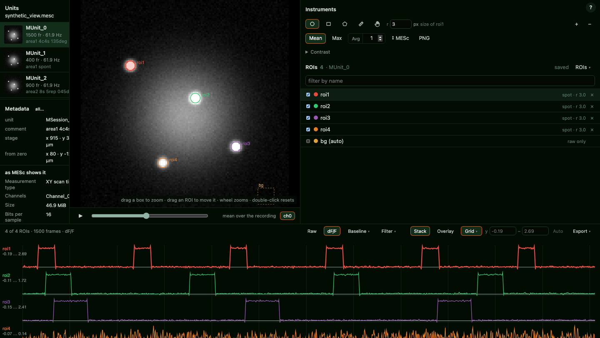
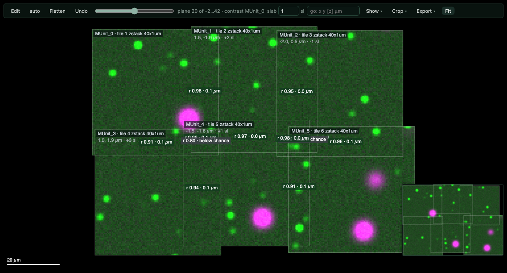

# mesc-io

[](https://github.com/LynnYuSmith/mesc-io/actions/workflows/tests.yml) [](https://pypi.org/project/mesc-io/) [](https://pypi.org/project/mesc-io/) [](LICENSE)

Open Femtonics `.mesc` two-photon recordings **without Windows and without MESc**: on macOS,
Linux or Windows, from Python, the command line or a browser. The frames come out in the units
the native reader shows, with every unit's metadata. Export to Fiji (which has no `.mesc`
reader), write processed frames back, motion-correct, and look at it all in a viewer that draws
ROIs and computes their dF/F.



## Install

```
pip install mesc-io
pip install "mesc-io[tiff,imagej]"     # + TIFF export, ImageJ ROI export
```

Needs Python 3.9 or newer, numpy and h5py; nothing else for reading and viewing. In the
viewer, the mosaic's crop to TIFF needs `[tiff]` and the ImageJ ROI export needs `[imagej]`.
Motion correction (`mesc-io register`) is an extra, `[register]`, and pulls in Suite2p 0.14.

## Python

```python
from mesc_io import MescFile

with MescFile("recording.mesc") as f:
    for u in f.units():
        print(u.path, u.shape, u.frame_rate_hz, u.pixel_size_um)

    frames = f.read("MUnit_0", channel=0)              # reader units, float64
    frames = f.read("MUnit_0", reader_units=False)     # the stored integers
    for block in f.iter_frames("MUnit_0", block=500):  # bigger than memory
        ...
```

`read` refuses over 4 GB by default (`max_gb=None` to override). A unit name that matches in
more than one session is refused, not resolved to the first; `MSession_1/MUnit_0` always works.

## Command line

```
mesc-io info      recording.mesc                            # units, rates, pixel sizes
mesc-io check     recording.mesc                            # what the file disagrees with itself about
mesc-io export    recording.mesc MUnit_0 u0.h5              # or u0.tif — a Fiji hyperstack
mesc-io export    recording.mesc all out_folder --tiff      # every unit, one .tif each
mesc-io writeback recording.mesc out.mesc MUnit_0 u0.h5     # processed frames back in
mesc-io view      recording.mesc                            # the recording in a browser
```

`info` and `check` take `--json`.

### Opening a recording in Fiji

Fiji has no reader for `.mesc` (Bio-Formats lists none for Femtonics), and its generic HDF5
import sees only the stored integers, without the units or the metadata. `export … .tif` writes what
Fiji opens with File ▸ Open as a calibrated hyperstack: every channel (`--channel N` for one), in
composite mode with each channel in its own colour and display range; the frame interval for a
recording or the slice spacing for a z-stack; x and y pixel sizes in µm; and the unit's comment,
the units and each channel's conversion under Image ▸ Show Info. Values are in reader units
(float32), as the native reader shows them; `--stored-units` keeps the file's integers. Frames are
streamed, so a unit larger than memory exports too.

### Motion correction

```
mesc-io register recording.mesc recording_MC.mesc          # one reference per unit
mesc-io preset save soma --block-size 128 --max-shift-nr 5 # name a set of settings
mesc-io register recording.mesc out.mesc --preset soma     # use it; a flag still wins
```

Needs `pip install "mesc-io[register]"`. The defaults are Suite2p non-rigid registration with
64-px blocks, `maxregshift` 0.1 and a non-rigid cap of 3 px, the settings of our lab's
(private) calcium-imaging pipeline, which they reproduce; z-stacks and units too short to
register are skipped and said so. Groups, presets, where they are kept and how to share them: [docs/registration.md](docs/registration.md).

### The viewer

`mesc-io view` opens the recording in a browser window: a private one when it finds Chrome,
Firefox or Edge (or Brave or Chromium), otherwise the default browser, and it says which:

- **left** — the units, a thumbnail each, and the unit's own metadata (rate, pixel size, the
  stage position and the position from the zero set on the rig);
- **middle** — the image: scrub it, average a window of N frames, zoom into a place by dragging a box;
- **right** — ROIs (spot, rectangle, polygon; drag to move, type a size);
- **bottom** — every ROI's time course, raw or dF/F by our lab's pipeline's method (`mesc_io.dff`,
  numpy only; checked against that (private) pipeline by tests that run where it is
  installed and are skipped in CI), stacked or overlaid, zoomed by
  dragging a box.

ROIs belong to the unit they were drawn on and are saved as you go, in one folder,
`~/mesc-viewer/`, never beside the raw file; so is the view itself, so reopening the file puts
you back where you were.

#### Brightness and colour

The picture is drawn in **fixed limits**: by default the display window the recording was saved
with on the rig (the file's own LUT, typically 0–2000 in reader units), the same for every
frame, so a frame that is dimmer looks dimmer. Bleaching, a change of laser power or a field
drifting out of focus show while you scrub. Type other limits per unit and channel (they live in
the view, never in the file; **file** brings the saved ones back), or switch to **auto %**, which
stretches the recording on percentiles of the whole unit: one window for every frame, so
scrubbing does not flicker.

Each channel has a palette: its colour from the file, a single colour, or one of 25 of Fabio
Crameri's perceptually uniform Scientific colour maps (batlow, oslo, lajolla, vik, roma, …).
**Overlay** puts all channels in one picture, each through its own limits and colour.

#### Z-stacks: 3D and XYZ

A z-stack is shown in slices and microns, with a max projection, a **3D** view you can turn
(MIP, semi-transparent, or coloured by depth) and **XYZ** orthogonal views through one crosshair.

- **overlay** — a two-channel stack in green and magenta, each channel through its own window
  and floor, white where both are bright (depth colouring stays one channel);
- **point** — the brightest voxel under a click: numbered, with its µm position, slice and each
  channel's value; also shown in XYZ;
- **measure** — the distance between two points in µm; shift+click goes on into a path, an axon's length;
- **box** clips the stack to six limits; **slab** draws only a thickness around the current slice, as MIP;
- **object** — grows a connected region from a clicked seed (voxels at least a share of its
  peak, within a radius) and gives its volume in µm³, centre, extent and each channel's mean;
  outlined in XYZ;
- **γ** per channel brightens the dim parts (below 1) or darkens them (above 1) in 3D, XYZ and
  the 3D PNG; at 1 the picture is unchanged.

#### Where the tissue begins

**surface** in XYZ: a few clicks in the XZ / YZ panes, just above the first slice where the
label appears, and a surface is fitted through them — flat from one mark, a tilted plane from
three, a curved one from six spread over the stack (a brain under a window is rarely level). It
is drawn in the panes, the tilt is given in degrees, and every 3D point and the crosshair get
their depth below it in µm, into the tissue: the brighter side of the stack, or the side you
set. **csv** saves the marks, the fit and the points' depths; the marks are kept with the view.

#### Mosaic



Shown when a file holds two or more z-stacks with a stage position: every tile laid out as one
field where the stage put it, a plane at a time, with hard seams (each pixel from the tile whose
centre is nearest, never an average of two places).

- **auto** stitches it from the overlaps: every overlapping pair matched in 3D (x, y and the
  slice), one correction per tile by least squares, each seam labelled with its correlation and
  what the solve left of it;
- **edit** moves a tile by hand (drag; arrows a pixel, [ ] a slice, h hides; ⌘Z undoes);
- **flatten** puts every tile's marked surface on one plane; double-click opens a tile in XYZ;
- **crop** + planes from–to + **TIFF** cut a piece out as a Fiji hyperstack, placed exactly as
  on screen; **layout** saves the corrections as JSON.

The same is in Python: `mesc_io.mosaic.tiles / register / compose / to_tiff`.

#### Measuring and figures

**ruler** (beside the ROI tools) measures in µm between two clicks on the image. **PNG** saves
what is on screen for a figure: the image at whole pixels with the ROIs, the ruler, a scale bar
and a caption, or the 3D view. **png** beside csv saves the traces.

Layout and decisions: [docs/viewer_design.md](docs/viewer_design.md).

To try it without a recording, make one:

```
python tools/make_synthetic.py            # writes synthetic_view.mesc: 3 units, 4 spots, 3 of them blinking
mesc-io view synthetic_view.mesc
```

## Related tools

A `.mesc` file is HDF5, so several tools open it. [roiextractors](https://github.com/catalystneuro/roiextractors)
and [NeuroConv](https://github.com/catalystneuro/neuroconv) (`FemtonicsImagingExtractor`,
`FemtonicsImagingInterface`) convert one unit and channel at a time to NWB;
[Suite2p](https://github.com/MouseLand/suite2p) reads `.mesc` as HDF5 through `h5py_key`;
[FIMAS](https://github.com/zhengkaiyu/FIMAS) (MATLAB) applies the channel conversion and tells time series from
z-stacks; and Femtonics' own [FemtoAPI](https://github.com/Femtonics/FemtoAPI) reads and writes everything through
a running, licensed MESc. The open Python readers we know of return the stored integers. mesc-io adds, without
MESc installed: frames in the units MESc shows (each channel's conversion, including the PMT offset), z-stacks
read as stacks, safe write-back into a copy of the `.mesc`, export to Fiji, and the browser viewer with mosaics.

**Not handled yet.** MESc can store PMT data inverted (an invert flag added in MESc 3.5.7; some readers apply
`65535 − x` by hand). mesc-io does not look for that flag: our files are not inverted and their values match
MESc, but an inverted file would read upside down. Files written by MES 7 or older (`.mes`) are a different
format and are not read.

## Development

```
pip install -e ".[tiff,dev]"
pytest
```

The package lives under `src/`, so tests run against the installed copy. CI runs the suite on
Python 3.9, 3.12 and 3.13 on Linux, macOS and Windows, plus one job with Suite2p for the
registration tests; the browser checks (`tests/*_real_chrome.js`) run in a real Chrome and are
not part of pytest.

## Acknowledgements

F. Kamari, for the idea. Claude Code, for the debugging.

## Licence

MIT — see [LICENSE](LICENSE).

The viewer's colour maps include Fabio Crameri's Scientific colour maps (v8.0, MIT, © 2020 Fabio
Crameri), taken via the cmcrameri package (C. Rollo; [licence](src/mesc_io/third_party/crameri_LICENSE.txt)). If a figure made with them goes
into a paper, cite: Crameri, F. (2018). *Scientific colour maps*. Zenodo.
https://doi.org/10.5281/zenodo.1243862
